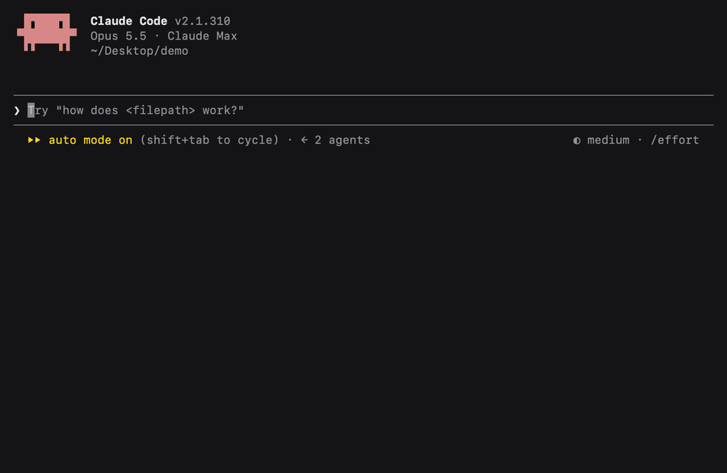

# Retro skins for Claude Code: iMessage, MSN Messenger, AIM and IRC

Retro Chat is a Claude Code mod that makes your chat look like the messengers you grew up with. Type `/skin msn` and Claude signs in.



## Install

In Claude Code:

```
/plugin install retro-chat --marketplace hg913488/claude-code-retro-skins
```

Then type `/skin` to see the skins, and `/skin imessage`, `/skin msn`, `/skin aim` or `/skin irc` to switch. `/skin off` puts everything back.

In the desktop app, click **+** next to the prompt box → **Plugins** → **Add marketplace** → `hg913488/claude-code-retro-skins` → **Add plugin**.

## The skins

| Skin | Your messages | While Claude works | When it's done |
|---|---|---|---|
| **iMessage** | Blue bubbles, "Delivered" | The gray typing bubble | A soft ding |
| **MSN Messenger** | `HG says:` | "Claude is typing a message" | The message chime and a popup with the first line of the reply |
| **AIM** | Timestamps, `5:24:03 PM` | An away message in the status line ("brb, writing code") | The IM chime |
| **IRC** | `[17:24] <HG>` | `* Claude is typing` | Silence. It's IRC. |

(The table uses the screen name HG; yours is set in Settings.)

MSN pops up "Claude has just signed in." when you switch to it. AIM's door opens when Claude signs on and closes when you leave. Every skin has its own pixel buddy next to the spinner: a speech bubble, a waving antenna, a running figure, a space invader.

The skin you pick stays on in new sessions until you change it.

## Settings

Open `/config` and find **retro-chat**:

- **Your name**: the screen name on your messages. Default `You`.
- **Sounds**: on by default. Turn it off for silence and keep the look.

The sounds play when you switch skins and when Claude finishes a turn that took 30 seconds or more. Short replies stay quiet.

## FAQ

**How do I turn the sounds off?**
`/config` → retro-chat → Sounds → off. Or `/skin off` to turn off the whole skin.

**Does it change what Claude sees or says?**
No. It only changes how the chat looks on your screen. Your prompts and Claude's answers are the same as without it.

**Does it work in the Claude desktop app?**
Yes. The desktop app gets real pixel art and the animated iMessage typing bubble. In the terminal, the skins are drawn in text.

**Which terminals does it work in?**
Any terminal Claude Code runs in. The pixel buddies use block characters, tested in Apple Terminal.

**Are those the real MSN and AIM sounds?**
No. They're new sounds made for this mod, in the spirit of the originals.

**How do I uninstall it?**
`/plugin uninstall retro-chat`, or `claude plugin uninstall retro-chat` from a shell.

**Can I make my own skin?**
Yes. A skin is one file in `skins/`. See [Make your own skin](docs/make-a-skin.md).

## Watch it

[A 27-second tour of all four skins](assets/retro-skins-tour.mp4)

---

MIT licensed. Made by [HG](https://github.com/hg913488). Not affiliated with Apple, Microsoft, AOL or Yahoo. iMessage, MSN Messenger and AIM are their owners' trademarks, named here only to describe the look.
